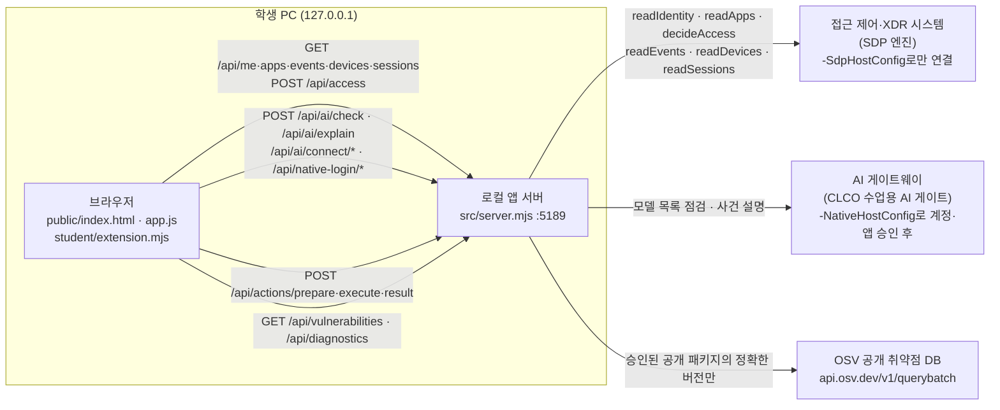

# 케셰브 학생 실행 설명서 (STUDENT_RUNBOOK)

이 문서는 학생이 직접 작성한 실행 설명서와 시스템 구성도입니다. 제공 문서(`README.md`, `docs/` 아래의 다른 파일)는 수정하지 않았으며, 이 문서가 학생 작성 부분의 README 역할을 합니다.

- 앱 이름: **케셰브 (KESHEV)** — ZTNA & XDR 보안 Agent
- 시작 틀: `alekov-client-starter` 0.2.11 (`package.json`의 `name`·`version`)
- 학생이 고친 코드: `student/extension.mjs` 한 파일 (13~20단계)
- 표기 규칙: **확인함(실제 PC)** = 학생 PC에서 직접 실행해 본 것, **확인함(모의)** = 모의 입력이나 예제 모드로만 점검한 것, **미확인** = 실행해 보지 못한 것

---

## 1. 목적과 기능

직원이 **본인의** 로그인·기기·세션 상태, 업무 앱 접근 판정, 최근 접속 기록과 저장된 XDR 경보, 앱 내부 AI 설명, 조치 요청 상태, 설치 패키지의 알려진 취약점 조회 결과를 한 화면에서 확인하는 보안 앱입니다.

메뉴는 세 개입니다: **보호 현황**, **업무 앱**, **보안 기록**.

이 앱이 하지 않는 일:
- 다른 직원의 기록이나 전체 이력을 보여 주지 않습니다(본인의 최근 기록 최대 40건).
- 실시간 전체 위협 탐지, 악성코드 검사·치료를 하지 않습니다.
- AI 설명·제안만으로 보안 조치를 실행하지 않습니다. 조치는 사람 확인 후 연동 시스템이 처리하며, 그 연결은 아직 준비되지 않았습니다.

---

## 2. 지원 환경과 실제로 확인한 버전

| 항목 | 요구 사항(코드 기준) | 실제로 확인한 값 | 상태 |
|---|---|---|---|
| 운영체제 | Windows (실행 도구가 PowerShell `.ps1`) | Windows 11 학원 PC | 확인함(실제 PC) |
| Node.js | `package.json` engines `24.19.0`, `tools/start-alekov.ps1`은 22~24 허용 | `node -v` → `v24.22.0` (실행 도구가 "수업 기준은 v24.19.0" 참고 문구만 출력하고 정상 실행) | 확인함(실제 PC) |
| 외부 npm 패키지 | 없음(의존성 0, `package-lock.json` 없음) | `npm install` 없이 실행됨 | 확인함(실제 PC) |
| 브라우저 | 최신 Chrome·Edge | Edge·Chrome에서 화면 확인 | 확인함(실제 PC) |
| Git | 커밋 안내 스크립트가 `git` 명령 사용 | `git --version` → `git version 2.56.0.windows.2`, 13~20단계 커밋·push 성공 | 확인함(실제 PC) |
| ALEPH 워크벤치 | 「포털 제출 준비」가 있는 학생용 판(0.6.0-preview.83 이상) | `0.6.0-preview.85` 설치 파일로 덮어 설치, 13~20단계 제출 동작 | 확인함(실제 PC) |

지원하지 않거나 확인하지 않은 환경: macOS·Linux에서의 `start-alekov.ps1` 실행, Node.js 21 이하·25 이상(실행 도구가 거부함), 학원 PC가 아닌 개인 PC.

---

## 3. 폴더 구조

워크벤치 프로젝트 폴더가 Git 저장소의 최상위입니다.

```text
%LOCALAPPDATA%\ALEPH\Workbench\projects\케셰브-방어전\      ← Git 최상위 (커밋은 여기서)
└─ on-client\                                               ← 앱 폴더 (실행은 여기서)
   ├─ package.json            scripts: start / demo / check
   ├─ .env.example            비밀 없는 설정 견본 (실제 키는 넣지 않음)
   ├─ .on-starter-manifest.json   시작 틀 파일 목록·해시 (커밋 안내가 사용)
   ├─ src\                    [제공] 로컬 앱 서버
   │  ├─ server.mjs           HTTP 서버, /api/* 경로
   │  ├─ engine.mjs, engine\  SDP 엔진(접근 제어·XDR) 연결
   │  ├─ ai\                  CLCO AI 게이트 연결·인증
   │  ├─ connection\          계정 연결(native 로그인)
   │  ├─ actions\             조치 준비·집행·결과 조회
   │  ├─ vulnerabilities\     package-lock 대조·OSV 조회
   │  └─ learner-support\     학습 지원
   ├─ public\                 [제공] 화면 (index.html, app.js, ai-connect.mjs, vulnerabilities-view.mjs, style.css)
   ├─ student\
   │  ├─ extension.mjs        [학생 작성] 학생 표시 함수 8개
   │  └─ engine-adapter.mjs   [제공 뼈대] 엔진 어댑터
   ├─ tools\                  [제공] start-alekov.ps1 등 실행 도구
   ├─ vendor\                 [제공] clco-http.mjs
   └─ docs\                   [제공] 안내 문서 + STUDENT_RUNBOOK.md [학생 작성]
```

---

## 4. 실행 절차

### 4-1. 처음 실행

1. 파일 탐색기에서 `Windows 키 + R` → `%LOCALAPPDATA%\ALEPH\Workbench\projects\케셰브-방어전\on-client` 입력 → 확인.
2. 탐색기 주소창 빈 곳을 클릭하고 `powershell` 입력 → Enter. 창 맨 아래 줄이 `...\on-client>`로 끝나야 합니다.
3. Node.js 확인:
   ```powershell
   node -v
   ```
   `v24.`로 시작하면 됩니다. "인식되지 않습니다"가 나오면 https://nodejs.org 에서 LTS(24.x) Windows 설치 프로그램(.msi)을 설치하고 **PowerShell 창을 새로 엽니다**.
4. 앱 실행(둘 중 하나):
   ```powershell
   # 기본 실행: 기존 서버(SDP)·AI에 연결하지 않은 상태. 화면에 "연결 없음"이 정상
   powershell -NoProfile -ExecutionPolicy Bypass -File .\tools\start-alekov.ps1

   # 예제 모드: 예제 자료로 화면 확인. 실제 연결이 아님
   powershell -NoProfile -ExecutionPolicy Bypass -File .\tools\start-alekov.ps1 -Demo
   ```
   `-ExecutionPolicy Bypass`는 이 한 번의 실행에만 적용되며 컴퓨터 설정을 바꾸지 않습니다. `npm start` / `npm run demo`도 같은 서버(`node src/server.mjs`)를 켭니다.
5. **정상 시작 신호**(PowerShell 창):
   ```text
   케셰브 연결 확인: http://127.0.0.1:5189      (예제 모드면 "케셰브 예제: ...")
   케셰브가 켜졌습니다. 브라우저에서 http://127.0.0.1:5189/ 을 여세요.
   서버가 응답한 것만 확인했습니다. AI 연결 상태는 화면에서 따로 확인해 주세요.
   끄려면 이 창에서 Ctrl+C 를 누르세요.
   ```
6. 브라우저 주소: **http://127.0.0.1:5189** — 화면 위 배지가 「연결 없음」 또는 「예제 데이터(demo) · 실제 연결 아님」으로 보입니다.

### 4-2. 종료

1. 앱을 켠 PowerShell 창을 클릭하고 `Ctrl+C`.
2. **확인**: 브라우저 새 탭에서 `http://127.0.0.1:5189`를 열어 「연결할 수 없습니다」가 나오면 꺼진 것입니다.
3. 화면이 계속 열리면 서버(node)가 남아 있는 것입니다. `Ctrl+Shift+Esc` → 작업 관리자에서 **Node.js JavaScript Runtime** → 「작업 끝내기」. (실행 도구가 node를 별도 프로세스로 띄우므로 Ctrl+C 뒤에도 남는 경우가 있었습니다 — 확인함(실제 PC))

### 4-3. 재실행

1. 위 종료를 먼저 확인합니다(포트 5189가 비어 있어야 함).
2. `on-client` 폴더의 PowerShell에서 4-1의 4번 명령을 다시 실행합니다.
3. 브라우저에서 F5. 화면 오른쪽 위 **「다시 불러오기」**는 서버를 끄고 켜는 것이 아니라 현재 서버에 자료를 다시 요청하는 버튼입니다.

### 4-4. 담당자가 연결 설정 파일을 준 경우에만

계정 연결·AI 앱 승인에는 `-NativeHostConfig`, 실제 SDP 연결에는 `-SdpHostConfig`에 **담당자가 안내한 설정 파일의 절대 경로**가 필요합니다. 학생이 직접 만들거나 복사하지 않습니다. `-Demo`와 `-SdpHostConfig`는 함께 쓸 수 없습니다.

```powershell
powershell -NoProfile -ExecutionPolicy Bypass -File .\tools\start-alekov.ps1 -NativeHostConfig "<담당자가 안내한 절대 경로>"
```

상태: 설정 파일을 받지 못해 **미확인**. 설정 없이 「계정 연결 시작」을 누르면 `NATIVE_HOST_DISABLED`가 나오는 것은 확인함(실제 PC).

### 4-5. 커밋 (Git 최상위 폴더에서)

1. 탐색기에서 `케셰브-방어전` 폴더(`on-client`의 바로 위)를 열고 주소창에 `powershell` → Enter.
2. 한글 폴더 이름 때문에 먼저 이 창의 출력 인코딩을 UTF-8로 바꿉니다(이 창에만 적용):
   ```powershell
   [Console]::OutputEncoding = [Text.Encoding]::UTF8; $OutputEncoding = [Text.Encoding]::UTF8
   ```
3. 방어전 상황실 4차 탭의 「PowerShell 커밋 안내」를 붙여 넣고 단계 번호(13~22) → `y`.
4. 백업이 필요하면 `git push`.

---

## 5. 시스템 구성도

### 5-1. Mermaid



### 5-2. 같은 내용의 글 설명

1. **브라우저**는 로컬 앱 서버(`http://127.0.0.1:5189`)에만 요청합니다. 외부 서버 주소나 열쇠를 브라우저에서 다루지 않습니다. 제공 화면(`public/app.js`)이 응답 형식을 검사한 뒤 학생 함수(`student/extension.mjs`)에 결과를 넘기고, 학생 함수는 표시용 DOM만 돌려줍니다.
2. **로컬 앱 서버**(`src/server.mjs`)는 `127.0.0.1`에만 열리며, 요청 종류에 따라 세 곳 중 하나로 연결합니다.
3. **접근 제어·XDR 시스템(SDP 엔진)**: 로그인·기기·세션, 업무 앱 접근 판정(`decideAccess`), 접속 기록·저장된 XDR 경보를 줍니다. `-SdpHostConfig` 없이 실행하면 연결하지 않고 「연결 없음」, `-Demo`면 예제 엔진을 씁니다.
4. **AI 게이트웨이(CLCO)**: `src/ai/connection.mjs`의 `CLCO_GATEWAY_ORIGIN`으로 연결합니다. 계정 연결과 앱 승인을 마친 뒤에만 모델 목록 점검(17단계)과 사건 설명(18단계)이 가능합니다. 원본 AI 열쇠는 중앙에만 있고 학생 PC·코드·문서에 없습니다.
5. **OSV**: `src/vulnerabilities/`가 `package-lock.json`과 설치된 `node_modules`를 대조한 정확한 버전 중 담당자가 승인한 공개 패키지만 `https://api.osv.dev/v1/querybatch`에 조회합니다. 승인 목록이 비어 있으면 외부 조회를 하지 않습니다.
6. 조치(`/api/actions/*`)는 서버가 지원하는 조치만 사람 확인 → 서버 전달 → 결과 재조회 순서로 처리하며, 연동 시스템 집행기는 아직 연결되지 않았습니다.

### 5-3. 표로 정리

| 출발 | 도착 | 경로·함수 | 언제 연결되나 |
|---|---|---|---|
| 브라우저 | 로컬 앱 서버 | `/api/*` (위 Mermaid) | 항상 |
| 로컬 앱 서버 | SDP 엔진 | `readIdentity`·`readApps`·`decideAccess`·`readEvents`·`readDevices`·`readSessions` | `-SdpHostConfig` 지정 시 (`-Demo`는 예제 엔진) |
| 로컬 앱 서버 | CLCO AI 게이트 | `src/ai/*`, `vendor/clco-http.mjs` | `-NativeHostConfig` + 계정 연결 + AI 앱 승인 후 |
| 로컬 앱 서버 | OSV | `src/vulnerabilities/osv.mjs` | 프로젝트 설정 + 승인된 공개 패키지가 있을 때 |

설정 견본 `on-client/.env.example`에는 비밀이 없는 값만 있습니다(`ON_PORT=5189`, `ON_ENGINE_ADAPTER`, `ON_AI_MODEL`, 비어 있는 `ON_PROJECT_DIRECTORY`, `ON_APPROVED_PUBLIC_PACKAGES=[]`). 키·토큰·비밀번호는 이 문서와 저장소 어디에도 적지 않습니다.

---

## 6. 제공 부분과 학생 작성 부분

| 구분 | 파일·함수 | 단계 | 하는 일 | 확인 상태 |
|---|---|---|---|---|
| 제공 | `src/**`, `public/**`, `tools/**`, `vendor/**`, 기존 `docs/**`, `README.md` | — | 서버, 화면, 응답 형식 검사, 버튼(다시 불러오기·접속 요청·AI 연결·조치·패키지 조회) | 수정하지 않음 |
| 학생 | `renderIdentity` | 13 | 사용자·기기·세션 표시, loading/error, 오류 때 이전 사용자 제거 | 확인함(실제 PC, 예제 모드·서버 끔) |
| 학생 | `renderDecision` | 14 | allow/deny/challenge/unknown과 요청 실패 구분, reason·checkedAt | 확인함(실제 PC, 예제 모드 3종) / unknown은 모의 |
| 학생 | `renderEvents` | 15 | 최신순 목록, 「기록 종류」「업무 앱」「접속 상태」 필터, 「<id> 상세」 | 확인함(실제 PC, 예제 1건) / 여러 건·xdr은 모의 |
| 학생 | `renderStatus` | 16 | 기기·세션·알림·도움정보, 「도움정보 복사」(6개 값만) | 확인함(실제 PC) |
| 학생 | `renderEvents` 상세 | 16 | 미지원 조치는 「<action> 미지원」 비활성 버튼 | 확인함(모의) — 실제 기록은 supportedActions 빈 배열 |
| 학생 | `renderAiConnection` | 17 | AI 연결 점검 idle/loading/ok/error, 오류 원인 8분류 | 권한 준비 중 화면 확인함(실제 PC) / ok는 모의 |
| 학생 | `renderExplanation` | 17·18 | 근거 ID 대조, 규칙, 확인 불가 상태, 제안·미실행 | 실패 화면 확인함(실제 PC) / 성공은 모의 |
| 학생 | `renderAction` | 19 | 준비·전달·접수(ACK)·효과 확인·결과 불명 구분 | idle 확인함(실제 PC) / 나머지 상태는 모의 |
| 학생 | `renderVulnerabilities` | 20 | 전체 조회 상태 5종, 정확한 설치 버전 표, 취약점 ID·modified | not_configured 확인함(실제 PC) / 표는 모의 |
| 학생 | `docs/STUDENT_RUNBOOK.md` | 21 | 이 문서 | — |

학생 함수는 `document.createElement`와 `textContent`만 쓰고, 서버 요청·자동 재시도·조치 버튼을 만들지 않습니다.

---

## 7. 오류별 확인 순서와 복구

| 증상·코드 | 어디서 보이나 | 확인 방법 | 복구 |
|---|---|---|---|
| "Node.js 가 없습니다" | 실행 도구 PowerShell | `node -v` | Node.js 24 LTS 설치 → PowerShell 새로 열기 |
| "포트 5189 를 다른 프로그램이 쓰고 있습니다" | 실행 도구 PowerShell | 브라우저에서 `http://127.0.0.1:5189`가 열리는지 | 이미 켜진 앱이면 그대로 사용, 아니면 작업 관리자에서 node 종료 또는 `-Port 5190` |
| 「연결 없음」, `ENGINE_NOT_CONNECTED` | 화면 위 배지·제공 칸 | 실행 명령에 `-SdpHostConfig`가 있는지 | 정상(학생 잘못 아님). 담당자 설정을 받은 뒤 다시 켜기 |
| "로컬 서버에 연결할 수 없습니다" | 학생 칸 「연결 실패」 | 앱 PowerShell 창이 켜져 있는지 | 앱을 다시 켜고 「다시 불러오기」를 직접 누름(자동 재요청 없음) |
| `TIMEOUT` (시간 초과) | 학생 칸 | 서버 창 상태 | 잠시 뒤 「다시 불러오기」를 직접 누름 |
| `CONTRACT_MISMATCH` (확인 불가) | 학생 칸 | 서버 응답 형식 이상 | 이전 목록을 지운 상태가 정상. 계속되면 도움정보를 복사해 담당자에게 |
| `NATIVE_HOST_DISABLED` | 「계정 연결 시작」 | `-NativeHostConfig` 지정 여부 | 담당자에게 설정 파일 요청 |
| `ON_AI_PROVISIONING_PENDING` (권한 준비 중) | AI 연결 점검·AI 설명 | 계정 연결·앱 승인 상태 | 담당자에게 계정·앱 권한 확인 요청(학생 잘못 아님) |
| `PROJECT_NOT_CONFIGURED` (not_configured) | 설치 패키지 조회 | 운영자 프로젝트 설정 | 정상(미조회). 설정을 임의로 바꾸지 않음 |
| `NO_APPROVED_PACKAGES` (not_checked) | 설치 패키지 조회 | 승인된 공개 패키지 목록 | 정상(미조회). 의존성을 임의로 바꾸지 않음 |
| 커밋 안내 "GetFullPath … 경로에 잘못된 문자" | 커밋 PowerShell | 한글 폴더 + 기본 인코딩 | 같은 창에서 4-5의 UTF-8 한 줄 실행 후 다시 붙여 넣기 |
| Ctrl+C 뒤에도 화면이 열림 | 브라우저 | 새 탭에서 주소 열기 | 작업 관리자에서 Node.js 「작업 끝내기」 |

도움 요청 시: 보호 현황 「도움정보 불러오기」 → 학생 칸 「도움정보 복사」(requestId·component·version·checkedAt·engine.mode·engine.code 6개만 복사) → 내용에 비밀이 없는지 읽은 뒤 담당자에게 전달.

---

## 8. 확인하지 못한 기능 (미확인)

| 기능 | 이유 |
|---|---|
| 실제 SDP(접근 제어·XDR) 연결과 실제 계정 자료 | `-SdpHostConfig` 설정 파일을 받지 않음 |
| 계정 연결·AI 앱 승인, AI 연결 점검 성공(test/verified) | `-NativeHostConfig` 설정 파일을 받지 않음(`NATIVE_HOST_DISABLED`) |
| 실제 AI 사건 설명 성공과 근거 ID 일치 | 위와 같음. 유료 요청을 반복하지 않음 |
| 조치 준비·집행·효과 관측(prepared→succeeded) | 연동 시스템 집행기 미연결, 현재 기록 supportedActions 빈 배열 |
| OSV 패키지 표(complete/partial)와 package-lock 버전 대조 | 프로젝트 설정·승인 패키지 미준비(not_configured) |
| 패키지 조회 중 「패키지 조회 취소」 | 예제 응답이 즉시 끝나 취소 시점을 만들지 못함 |
| Windows 외 운영체제, Node.js 22·23에서의 실행 | 학원 PC(Windows, Node v24.22.0)에서만 실행 |
